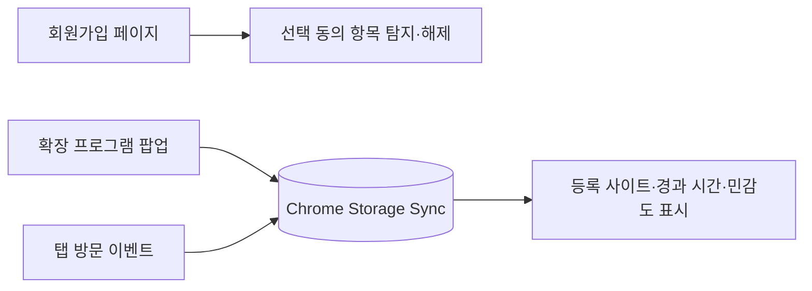

# P-GRAB

회원가입 페이지의 선택적 개인정보 동의 항목을 해제하고, 웹사이트별로 제공한 개인정보의 **종류**와 마지막 방문 시점을 관리하는 Chrome 확장 프로그램입니다. 기존 표시 이름은 AdCheck-Free입니다.

## 기술 스택

Chrome Manifest V3 · JavaScript ES Modules · Chrome Storage Sync · HTML/CSS

## 실행

1. 이 저장소를 다운로드하거나 복제합니다.
2. Chrome에서 `chrome://extensions`를 열고 **개발자 모드**를 켭니다.
3. **압축해제된 확장 프로그램을 로드합니다**에서 `manifest.json`이 있는 폴더를 선택합니다.

팝업에서 웹사이트를 등록하고 제공한 개인정보 항목을 선택합니다. 실제 이름·계좌번호·비밀번호를 입력하거나 저장하는 기능은 없습니다. 등록 내용은 Chrome의 동기화 저장소에 보관됩니다.

## 동작 원리

- 페이지 주소가 manifest의 회원가입 경로와 일치할 때만 체크박스를 검사합니다.
- 페이지 내용이 바뀌면 다시 검사하며 중복 이벤트 등록을 방지합니다.
- 민감도 색상은 프로젝트의 항목 분류 기준이며 법적 등급이나 보안 진단 결과는 아닙니다.
- 사이트마다 동의 화면 구조가 다르므로 실제 체크 상태를 확인해야 합니다.
- 기존 점→하이픈 저장 키를 읽고, 수정 시 도메인 충돌을 피하는 새 키로 옮깁니다.

## 개발·검증

Node.js 22 이상에서 `npm ci`, `npm test`를 실행합니다. `npm run format:check`로 코드 형식을 확인합니다. 설치된 확장 프로그램을 수정한 뒤에는 확장 관리 화면에서 새로고침합니다.

원본: 사용자가 제공한 `P-GRAB-main.zip` ([원 프로젝트](https://github.com/Stepwise-ssu/P-GRAB)). 원본의 저작권 표시는 유지했습니다. 운영 데이터·계정·브라우저 저장 데이터는 포함하지 않습니다.
