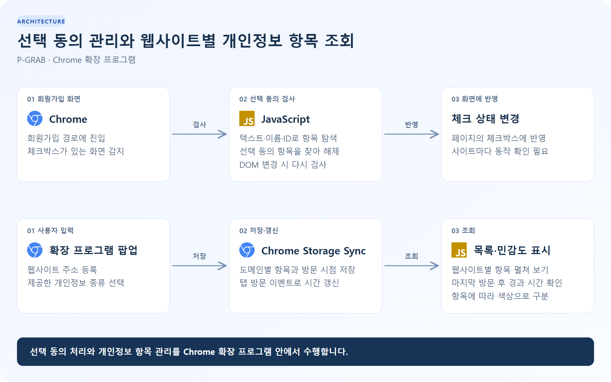
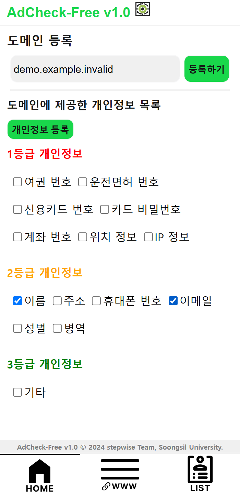
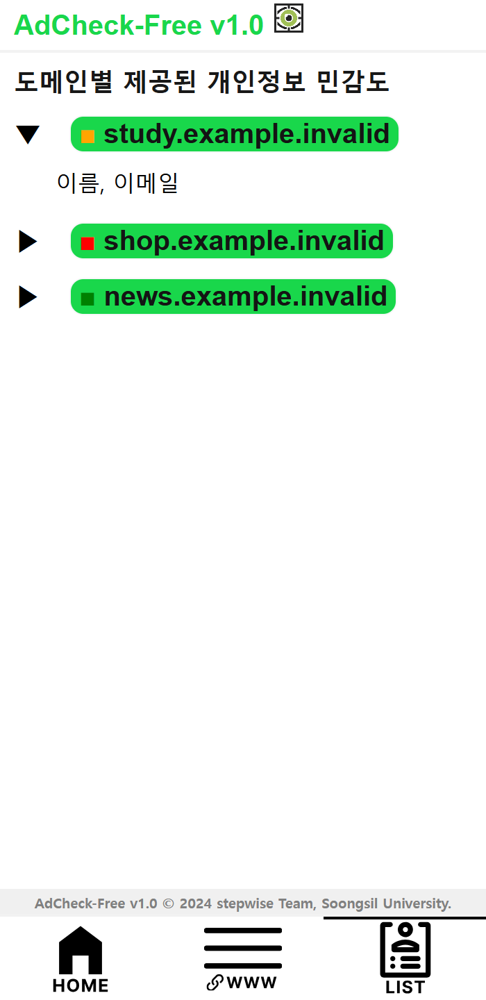

# P-GRAB

[](https://github.com/leedidc/P-GRAB/actions/workflows/check.yml)

## 프로그램 용도

회원가입 화면의 선택 동의 항목을 해제하고, 웹사이트에 제공한 개인정보의 종류를 관리하는 Chrome 확장 프로그램입니다. 등록한 사이트마다 어떤 항목을 제공했는지, 마지막으로 언제 방문했는지 확인할 수 있습니다.

화면에 표시되는 이름은 **AdCheck-Free**입니다. 실제 이름이나 비밀번호를 보관하는 대신, ‘이름’, ‘이메일’처럼 제공한 정보의 종류만 기록합니다.

## 기술 스택

| 구분             | 사용 기술                                |
| ---------------- | ---------------------------------------- |
| 실행 환경        | Chrome Extensions, Manifest V3           |
| 화면·로직        | JavaScript ES Modules, HTML, CSS         |
| 데이터 저장      | Chrome Storage Sync                      |
| 테스트·코드 검사 | Node.js, jsdom, Prettier, GitHub Actions |

## 아키텍처

[](docs/images/architecture.svg)

콘텐츠 스크립트가 회원가입 화면의 선택 동의 항목을 검사합니다. 팝업에서 등록한 사이트와 개인정보 항목은 Chrome 동기화 저장소에 보관하고, 탭 방문 이벤트로 마지막 방문 시점을 갱신합니다.

[구성도 크게 보기](docs/images/architecture.svg)

## 실행 화면

예제 주소를 넣은 팝업 화면입니다. 실제 방문 기록이나 개인정보는 사용하지 않았습니다.

| 웹사이트·개인정보 항목 등록                                                                                    | 사이트별 개인정보 항목 조회                                                                           |
| -------------------------------------------------------------------------------------------------------------- | ----------------------------------------------------------------------------------------------------- |
| [](docs/images/register-demo.png) | [](docs/images/privacy-demo.png) |

## 실행 방법

1. 저장소를 다운로드하거나 복제합니다.
2. Chrome 주소창에 `chrome://extensions`를 입력합니다.
3. **개발자 모드**를 켜고 **압축해제된 확장 프로그램을 로드합니다**를 선택합니다.
4. `manifest.json`이 있는 프로젝트 폴더를 선택합니다.
5. 확장 프로그램을 열어 웹사이트 주소와 제공한 개인정보 항목을 등록합니다.

확장 프로그램을 실행하는 데 별도 서버는 필요하지 않습니다. 코드를 수정한 뒤에는 확장 프로그램 관리 화면에서 새로고침합니다.

<details>
<summary>개발 환경에서 테스트하기</summary>

Node.js 22 이상에서 실행합니다.

```sh
npm ci
npm test
npm run format:check
```

</details>

## 기능

| 기능               | 설명                                                      |
| ------------------ | --------------------------------------------------------- |
| 선택 동의 처리     | 지원하는 회원가입 경로에서 선택 동의 체크박스를 찾아 해제 |
| 웹사이트 관리      | 사이트 등록·삭제, 개인정보 항목 추가                      |
| 개인정보 항목 조회 | 사이트별로 제공한 정보의 종류를 펼쳐 확인                 |
| 민감도 표시        | 등록된 항목을 프로젝트의 분류 기준에 따라 색상으로 구분   |
| 방문 이력 확인     | 등록한 사이트의 마지막 방문 시점과 경과 시간 표시         |
| 데이터 유지        | Chrome 동기화 저장소 사용, 기존 형식의 저장 데이터 지원   |

사이트마다 동의 화면 구조가 달라 모든 사이트에서 같은 방식으로 동작하지는 않습니다. 실제 체크 상태를 확인해 주세요.

[원 프로젝트 · Stepwise 팀](https://github.com/Stepwise-ssu/P-GRAB) · [이미지 출처](docs/images/ATTRIBUTION.md)
